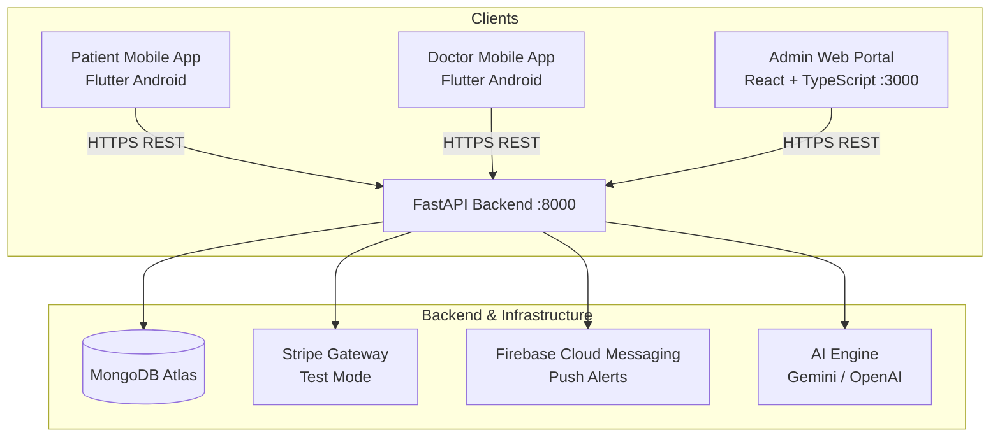

# MediConnect — Digital Healthcare Management Platform

[](https://github.com/rusiru-242/MediConnect/actions/workflows/backend-ci.yml)
[](https://github.com/rusiru-242/MediConnect/actions/workflows/admin-web-ci.yml)
[](https://github.com/rusiru-242/MediConnect/actions/workflows/mobile-ci.yml)

MediConnect is a comprehensive, production-grade digital healthcare platform engineered to streamline patient consultations, doctor appointment scheduling, verified professional onboarding, digital prescription delivery, smart medication tracking, and administrative governance.

---

## 1. System Architecture & Component Roles

MediConnect adopts a strict three-tier architecture with role-isolated client experiences:



### Role & Platform Separation:
- **Flutter Mobile App (`mobile/`)**: Exclusively serves **Patients** and **Doctors**. Patients search doctors, book appointments, make Stripe payments, manage prescriptions, and receive medication reminders. Doctors manage availability, review patient consultations, and issue digital prescriptions. **All administrative screens, routes, and navigation have been migrated off mobile.**
- **React Admin Web Portal (`admin-web/`)**: Exclusively serves **System Administrators**. Provides doctor SLMC credential verification, patient and doctor user management, financial tracking, review moderation, health article publishing, and platform KPI analytics.
- **FastAPI Shared Backend (`backend/`)**: Unified RESTful API gateway enforcing role-based access control (RBAC), database connection lifecycles, cryptographic webhook validation, and background appointment reminder dispatch.
- **MongoDB Atlas**: Managed multi-tenant cloud document database with automated compound indexes preventing double bookings and ensuring data integrity.

---

## 2. Technology Stack

| Layer | Technologies |
| :--- | :--- |
| **Mobile Client** | Flutter 3.29+, Dart 3.7+, Provider, Material 3, Flutter Stripe, Firebase Messaging |
| **Admin Web Portal** | React 18, TypeScript 5, Vite 5, Tailwind CSS, TanStack Query v5, Recharts, Lucide Icons |
| **Backend API** | Python 3.12+, FastAPI, Uvicorn (ASGI), Pydantic v2, PyJWT, Motor / PyMongo |
| **Database** | MongoDB Atlas (Replica Set, M10+ recommended) |
| **Payments** | Stripe PaymentIntents & Webhooks (Maintained strictly in Test Mode) |
| **Push Notifications** | Firebase Cloud Messaging (FCM) with sanitized, privacy-safe payloads |
| **AI Integrations** | Google Gemini / OpenAI (Doctor recommendations, booking assistant, health chat) |
| **CI / CD** | GitHub Actions workflows with least-privilege permissions |

---

## 3. Repository Directory Structure

```text
MediConnect/
├── .github/
│   └── workflows/              # GitHub Actions CI pipelines (backend, admin-web, mobile)
├── admin-web/                  # React + TypeScript Web Admin Portal
│   ├── src/                    # Components, pages, hooks, context, API clients
│   ├── Dockerfile              # Multi-stage Nginx container build
│   └── package.json            # Scripts: dev, build, lint, typecheck, test
├── backend/                    # FastAPI Shared REST Backend
│   ├── app/                    # Routes, models, schemas, services, middleware, agents
│   ├── tests/                  # Pytest automated test suites (19 modules, 190 tests)
│   ├── Dockerfile              # Hardened non-root Python 3.12-slim image
│   └── requirements.txt        # Backend Python dependencies
├── docs/                       # Project engineering documentation & runbooks
│   ├── DEPLOYMENT_RUNBOOK.md   # Production deployment and rollback protocol
│   ├── DEVELOPER_SETUP.md      # Local developer setup guide (PowerShell)
│   ├── SYSTEM_ARCHITECTURE.md  # Detailed architecture & security design
│   ├── API_OVERVIEW.md         # Complete FastAPI endpoint reference
│   ├── OPERATIONS_AND_TROUBLESHOOTING.md # Operational diagnosis guide
│   └── FINAL_ISSUES_AND_BLOCKERS.md     # Unresolved issues register
├── mobile/                     # Flutter Android Application (Patient + Doctor)
│   ├── lib/                    # Screens, providers, models, core themes
│   ├── test/                   # Flutter widget and unit test suites (177 tests)
│   └── android/                # Gradle build configs, network security, manifest
├── docker-compose.yml          # Production container orchestration
└── README.md                   # Platform documentation entrypoint
```

---

## 4. Local Development Setup (Quick Start)

### Prerequisites:
- Python 3.12+
- Node.js 20+ (LTS) & npm
- Flutter SDK 3.29+ & Android Studio / SDK
- Active MongoDB Atlas connection URI or local MongoDB instance

### A. FastAPI Backend Setup
```powershell
# Navigate to backend
cd backend

# Create and activate virtual environment
python -m venv venv
.\venv\Scripts\Activate.ps1

# Install dependencies
pip install -r requirements.txt

# Configure environment variables
Copy-Item .env.example .env
# Edit .env with your MONGODB_URI and JWT_SECRET

# Start development server
uvicorn app.main:app --reload --host 127.0.0.1 --port 8000
```
- Health Probe: `http://127.0.0.1:8000/health`
- Interactive Swagger Docs: `http://127.0.0.1:8000/docs`

### B. React Admin Web Setup
```powershell
# Navigate to admin-web
cd admin-web

# Install dependencies
npm ci

# Configure environment variables
Copy-Item .env.example .env

# Start development server
npm run dev
```
- Console runs at: `http://localhost:5173`

### C. Flutter Mobile Setup
```powershell
# Navigate to mobile
cd mobile

# Fetch dependencies
flutter pub get

# Run on connected device or emulator
flutter run --dart-define=API_BASE_URL=http://10.0.2.2:8000
```

---

## 5. Automated Verification & Test Commands

Every component includes an exhaustive automated verification suite:

```powershell
# Backend Verification (190 passing tests)
cd backend
.\venv\Scripts\Activate.ps1
python -m compileall app
pytest -q

# React Admin Verification (Lint, Typecheck, 28 Vitest tests, Production build)
cd admin-web
npm run lint
npm run typecheck
npm run test
npm run build

# Flutter Mobile Verification (Static analysis, 177 unit/widget tests)
cd mobile
flutter analyze
flutter test
```

---

## 6. Environment Configuration & Security

MediConnect uses environment-specific isolation. **Never commit `.env` files, keystores, or private credentials to version control.**

### Backend Required Keys (`backend/.env`):
- `MONGODB_URI`: MongoDB Atlas connection string (`mongodb+srv://...`)
- `DATABASE_NAME`: Target database name (e.g., `mediconnect`)
- `JWT_SECRET`: Cryptographically strong random secret key (minimum 32 bytes / 256 bits in production)
- `ALLOWED_ORIGINS`: Comma-delimited CORS allowlist (e.g., `https://admin.mediconnect.lk`)
- `STRIPE_SECRET_KEY`: Stripe API secret key (must use `sk_test_...` until launch)
- `STRIPE_WEBHOOK_SECRET`: Stripe signing secret (`whsec_...`)
- `FIREBASE_CREDENTIALS_PATH`: Optional path to service account JSON

### Admin Web Keys (`admin-web/.env`):
- `VITE_API_BASE_URL`: Public backend endpoint (e.g., `https://api.mediconnect.lk/api`)

---

## 7. Security & Privacy Safeguards

- **Strict RBAC**: Independent server-side role validation (`PATIENT`, `DOCTOR`, `ADMIN`).
- **IDOR Protections**: Medical records and prescriptions strictly enforce caller identity; cross-patient data access returns HTTP 403 Forbidden.
- **Defensive Headers**: `X-Content-Type-Options: nosniff`, `X-Frame-Options: DENY`, `X-XSS-Protection: 1; mode=block`, `Referrer-Policy: strict-origin-when-cross-origin`.
- **Sanitized Notifications**: Push notifications contain zero diagnostic data or medication names.
- **Payment Safety**: Automated HMAC SHA-256 verification on all Stripe webhooks with replay-prevention idempotency.

---

## 8. Deployment & Handover Documentation

Detailed operations and deployment guides are located in the `docs/` directory:
- [docs/DEPLOYMENT_RUNBOOK.md](file:///C:/Users/REDTECH/Downloads/MediConnect/docs/DEPLOYMENT_RUNBOOK.md) — Production deployment procedures, container specs, and rollback protocol.
- [docs/DEVELOPER_SETUP.md](file:///C:/Users/REDTECH/Downloads/MediConnect/docs/DEVELOPER_SETUP.md) — Comprehensive developer workstation setup instructions.
- [docs/SYSTEM_ARCHITECTURE.md](file:///C:/Users/REDTECH/Downloads/MediConnect/docs/SYSTEM_ARCHITECTURE.md) — Architectural workflows, data models, and boundary specifications.
- [docs/API_OVERVIEW.md](file:///C:/Users/REDTECH/Downloads/MediConnect/docs/API_OVERVIEW.md) — Complete REST endpoint reference.
- [docs/OPERATIONS_AND_TROUBLESHOOTING.md](file:///C:/Users/REDTECH/Downloads/MediConnect/docs/OPERATIONS_AND_TROUBLESHOOTING.md) — Operational diagnostic runbook.
- [docs/FINAL_ISSUES_AND_BLOCKERS.md](file:///C:/Users/REDTECH/Downloads/MediConnect/docs/FINAL_ISSUES_AND_BLOCKERS.md) — Outstanding issues register.
- [docs/PHASE37_FINAL_HANDOVER_REPORT.md](file:///C:/Users/REDTECH/Downloads/MediConnect/docs/PHASE37_FINAL_HANDOVER_REPORT.md) — Final roadmap milestone handover report.
- [docs/FINAL_LAUNCH_APPROVAL_CHECKLIST.md](file:///C:/Users/REDTECH/Downloads/MediConnect/docs/FINAL_LAUNCH_APPROVAL_CHECKLIST.md) — Pre-launch governance and sign-off checklist.
- [docs/FINAL_RELEASE_SUMMARY.md](file:///C:/Users/REDTECH/Downloads/MediConnect/docs/FINAL_RELEASE_SUMMARY.md) — Executive release summary.
