<p align="center">
  
</p>

# MediConnect — Advanced Agentic AI Healthcare Platform

[](https://github.com/rusiru-242/MediConnect/actions/workflows/backend-ci.yml)
[](https://github.com/rusiru-242/MediConnect/actions/workflows/mobile-ci.yml)
[](https://github.com/rusiru-242/MediConnect/actions/workflows/admin-web-ci.yml)

MediConnect is an advanced full-stack healthcare management platform that combines hybrid Agentic AI orchestration, trusted backend tools, intelligent automation and human-controlled clinical and financial workflows across patient, doctor and administrative environments.

> **Academic demonstration / engineering preview (v1.0.0-academic).** MediConnect is not clinically validated, not a medical device, not approved for real patients and not production-ready. Demonstrations use synthetic data, a local database and Stripe test mode only. See [Known limitations](#known-limitations).

## Contents

- [Overview](#overview)
- [Key features](#key-features)
- [Hybrid Agentic AI architecture](#hybrid-agentic-ai-architecture)
- [System architecture](#system-architecture)
- [Security and data](#security-and-data)
- [Verification results](#verification-results)
- [Screenshots](#screenshots)
- [Getting started](#getting-started)
- [Project structure](#project-structure)
- [Known limitations](#known-limitations)
- [Documentation](#documentation)

## Overview

| | |
|---|---|
| **Problem** | Patients need help finding the right doctor, booking and paying safely, following prescriptions and getting support. Clinicians and administrators need tools that save time without taking decisions away from them |
| **Approach** | One FastAPI backend serves a Flutter app for patients and doctors and a React admin web app. An AI layer understands requests in English and Sinhala, calls only authorised read-only tools over trusted data, and proposes actions that a person confirms |
| **Objectives** | Truthful AI assistance grounded in stored records; explicit human approval for every booking, payment, refund, prescription and account action; privacy by role and care relationship; honest empty and error states |

## Key features

**Patient app (Flutter, Android)**
- AI Health Assistant: emergency triage first; grounded medicine and wellness information; no diagnosis or dosing.
- Contextual doctor discovery: specialty, city and budget refinement with conversation memory; cards built from verified doctor records.
- Multi-step appointment booking: real slots, a booking proposal, explicit Accept, a timed hold, and Stripe payment (test mode).
- Medicine package image analysis: reads printed text through an optional vision model, with refusal rules; never dosing.
- Medication reminders locked to the clinician's instructions; appointment, follow-up and medical-test reminders (in-app).
- Prescription viewing and renewal requests.
- Profile data (only stored values) and secure profile pictures.
- Notifications, Help and Support tickets, and Emergency SOS with verified Sri Lankan numbers.

**Doctor app (same Flutter app, doctor role)**
- Dashboard, schedule and availability, appointment queue and consultation workflow.
- Consultation preparation from authorised records; clinical notes signed by the doctor.
- Prescription issuance with allergy and active-medicine checks; nothing pre-filled.
- Renewal review (approve, reject or require a consultation), care plans and follow-ups.
- Approved reminder messages to patients; profile picture.

**Admin web (React + TypeScript)**
- Dashboard and analytics, doctor management and verification, appointment monitoring.
- Payments, refunds (admin approval, idempotent) and reconciliation.
- Fraud signals for human review (no automatic action), customer support with admin-sent replies.
- System and notification monitoring with measured states, and audit logs.

**Implemented differently, or not at all:**
- There's no SLMC registry integration: doctor registration details are reviewed manually.
- There's no clinically validated drug-interaction source.
- External push, e-mail and SMS delivery are not configured.
- Free-text doctor–patient messaging doesn't exist.
- There are no cryptographic, tamper-evident signatures.

## Hybrid Agentic AI architecture

MediConnect has **38 AI-assisted, automation and shared infrastructure components**. They are not 38 autonomous LLM agents.

| Class | Count | Components |
|---|---|---|
| LLM-assisted agents | 2 | Health Assistant, Medicine Image Analysis |
| Hybrid AI agents | 2 | Appointment Booking Agent, Doctor Recommendation |
| Deterministic workflow assistants | 15 | e.g. Prescription Assistant, Consultation Preparation, Customer Support |
| Rule-based automation services | 13 | e.g. reminders, fraud signals, refunds, monitoring, scheduler |
| Shared AI infrastructure | 6 | Orchestrator, Provider Management, Intent Classification, Emergency Triage, Conversation Memory, Safety Guard |

**LLM paths:**
- 7 components have an optional, bounded LLM path. A model may propose an intent label, search preferences, a read-only tool call, a rephrasing or an image reading; the server validates all of it.
- The other 31 components are deterministic.
- With no provider configured, everything runs on the deterministic engine.

**Capabilities:**
- orchestration with validated, role-authorised tool calling;
- intent classification;
- conversation memory;
- trusted retrieval;
- multilingual understanding (English, Sinhala, romanised Sinhala);
- multimodal image reading;
- provider fallback (Gemini primary, OpenAI secondary, then deterministic);
- prompt-injection safeguards;
- human-in-the-loop execution.

**Live use:**
- Gemini was exercised live, text and vision, on synthetic data in authorised tests.
- OpenAI live generation was not run (no account credits).
- The final verification (R03) used the deterministic engine and test doubles, with no live AI calls.

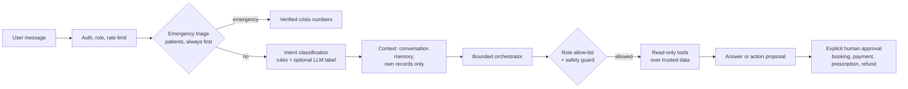

Full component table, entry points and evidence: [Agentic AI architecture](docs/uat/MEDICONNECT_ADVANCED_AGENTIC_AI_ARCHITECTURE.md).

## System architecture

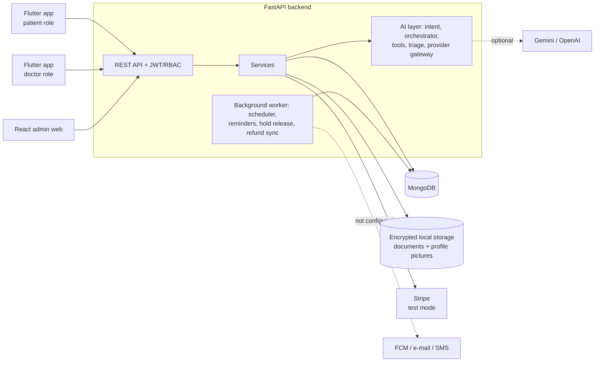

Booking, clinical and payment flows: [Architecture overview](docs/ARCHITECTURE_OVERVIEW.md).

| Layer | Technology |
|---|---|
| Mobile | Flutter (Dart ≥ 3.7; verified with Flutter 3.47.5), Provider, flutter_stripe, image_picker, flutter_local_notifications |
| Admin web | React 18, TypeScript 5, Vite 5, TanStack Query 5, Tailwind CSS 3, Recharts |
| Backend | Python (CI 3.12; local 3.13), FastAPI, Pydantic 2, PyMongo, PyJWT, Pillow, ReportLab, cryptography |
| Data | MongoDB (local `mediconnect_uat` for demonstrations) |
| Integrations | Stripe PaymentIntents and webhooks (test mode); optional Gemini / OpenAI |
| CI | GitHub Actions, path-filtered: backend, mobile, admin web |

## Security and data

| Area | What is enforced |
|---|---|
| Authentication | Short-lived JWT access tokens, refresh-token rotation, logout revocation |
| Authorisation | Role checks on every route; object-level ownership; clinical data only with a care relationship; admins cannot read clinical records or patient pictures |
| AI | Role allow-lists for tools, argument validation, call limits, mutating tools need confirmation, no account data sent to providers |
| Payments | Server-owned amounts, ownership checks before any Stripe call, signed and idempotent webhooks, idempotent refunds |
| Storage | Documents, medicine photos and profile pictures encrypted at rest (AES-256-GCM); pictures re-encoded to 512×512 without metadata; no public file routes |
| Data model | MongoDB collections for users, doctor profiles, appointments, payments, prescriptions, records, reminders, notifications, tickets, fraud assessments and audit logs |

**Open security blocker:** a database credential exists in the public Git history. Until the owner confirms rotation, MediConnect should only be run as a local demonstration with synthetic data. See [Security verification](docs/uat/release-preparation/r03/R03_SECURITY_VERIFICATION_REPORT.md).

## Verification results

These are the final engineering verification results (R03, 2026-11-28, commit `4f64295`), local environment only:

| Measure | Result |
|---|---|
| Backend tests (fresh local database) | 1,064 passed |
| Flutter tests | 362 passed |
| Admin web tests | 51 passed |
| Total | **1,477 passed, 0 failed, 0 skipped**; 0 unintended provider connections |
| Components | 29 verified locally, 9 partially verified, 0 blocked |
| Defect tracker | 340 items; 262 confirmed defects, 261 fixed, 1 open (a product decision) |

"Verified" means local engineering verification (automated tests, emulator, browser); no clinician, pharmacist or physical device was involved. Details: [final engineering summary](docs/uat/MEDICONNECT_FINAL_ENGINEERING_SUMMARY.md) and [component matrix](docs/uat/MEDICONNECT_FINAL_38_COMPONENT_VERIFICATION_MATRIX.md).

## Screenshots

These are genuine captures from the Android emulator and the admin web, with synthetic accounts and images. Sources: [SCREENSHOTS.json](docs/assets/screenshots/SCREENSHOTS.json).

| | | | |
|---|---|---|---|
| <br>Splash | 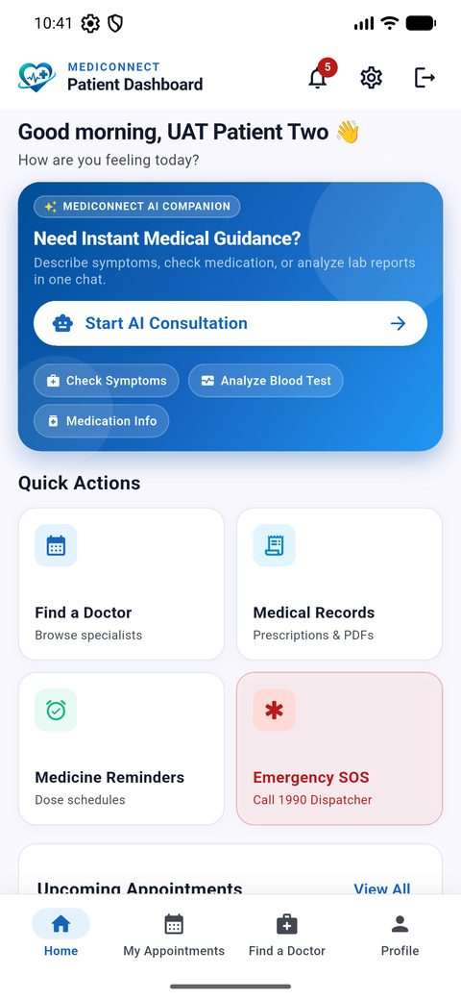<br>Patient dashboard | 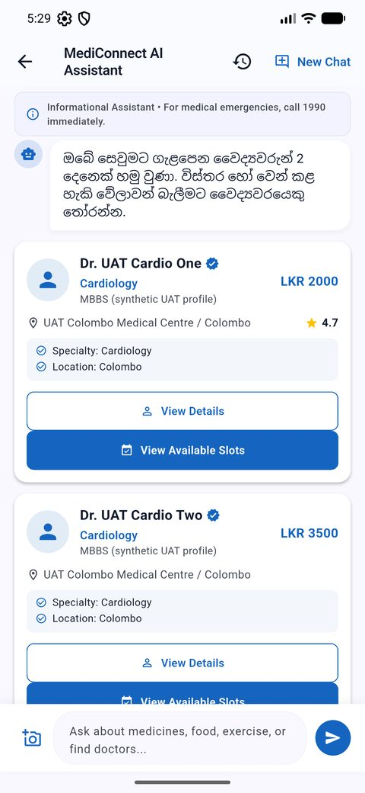<br>Sinhala doctor search | 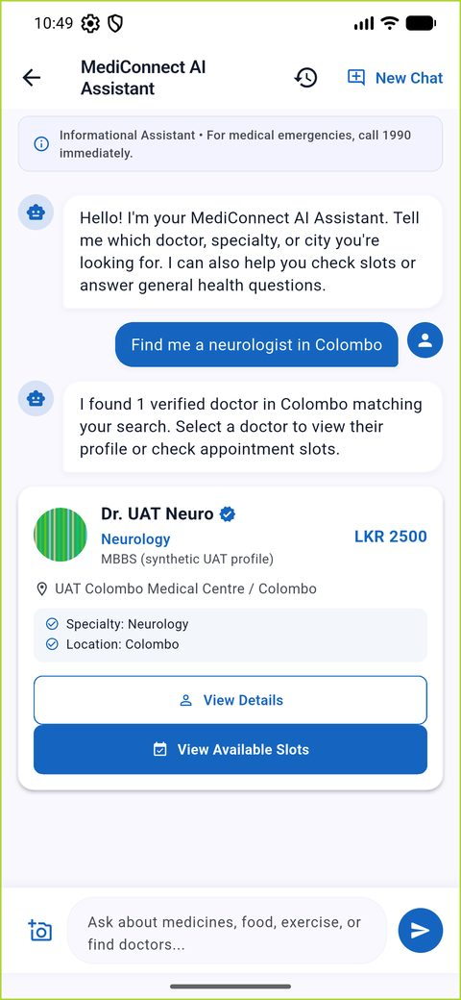<br>AI doctor card |
| 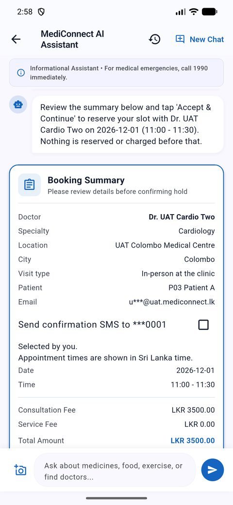<br>Booking proposal | 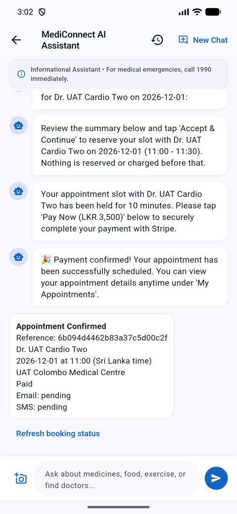<br>Stripe test payment | 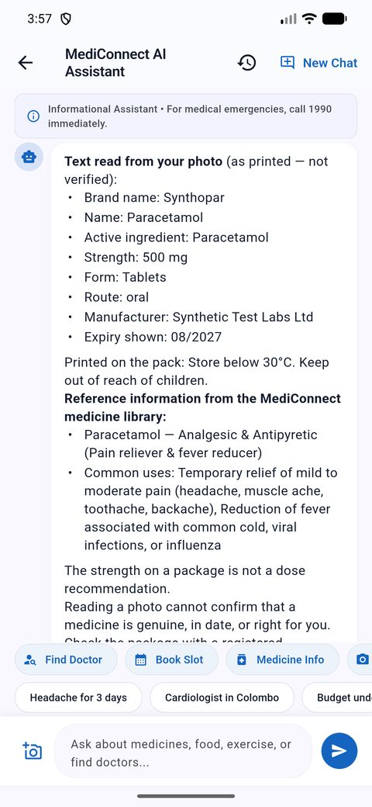<br>Medicine image analysis | 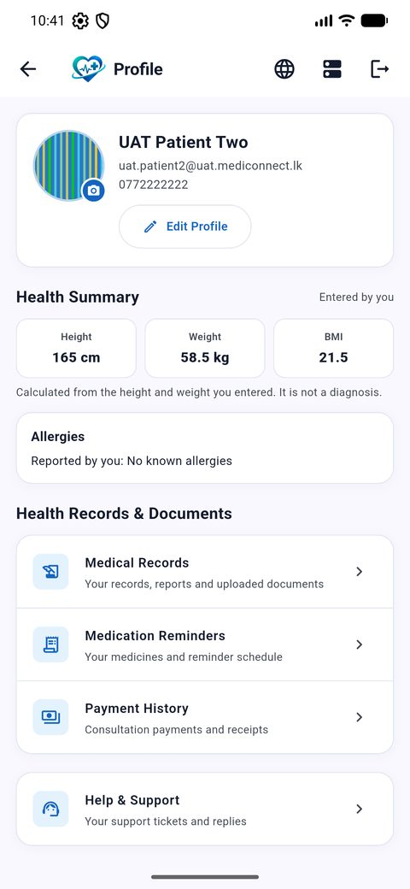<br>Profile and picture |
| 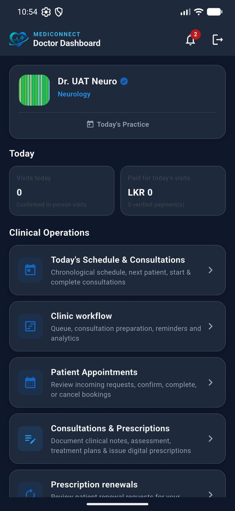<br>Doctor dashboard | 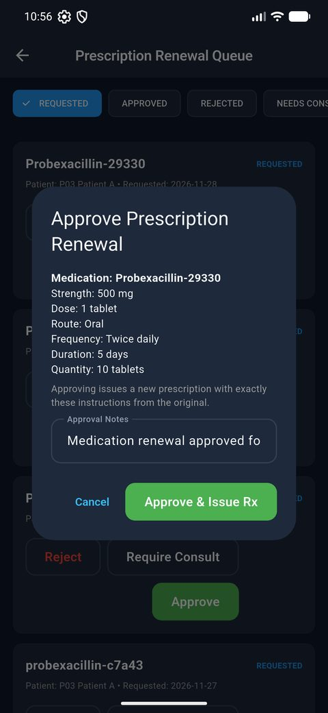<br>Clinician approval | 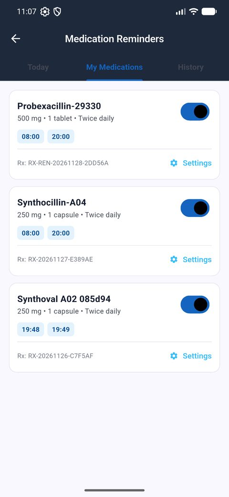<br>Medication reminders | 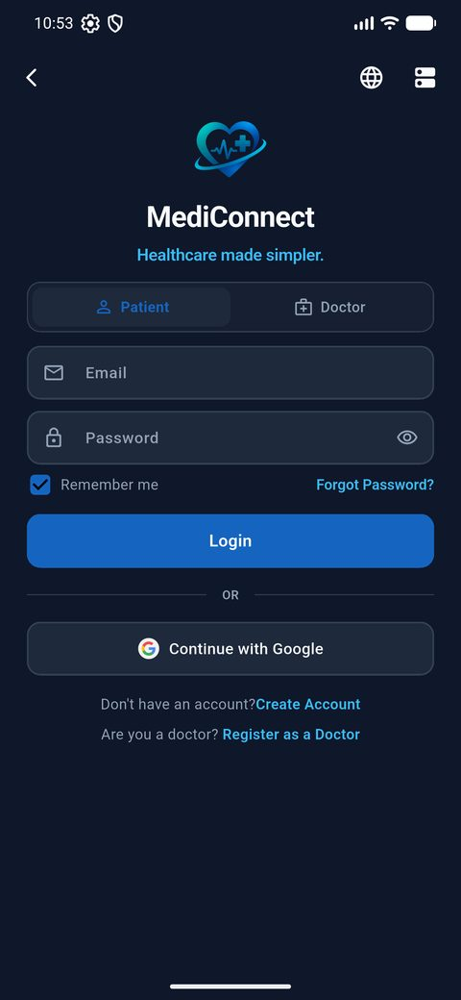<br>Dark theme |

| Admin dashboard | Fraud signal review | Support queue |
|---|---|---|
| 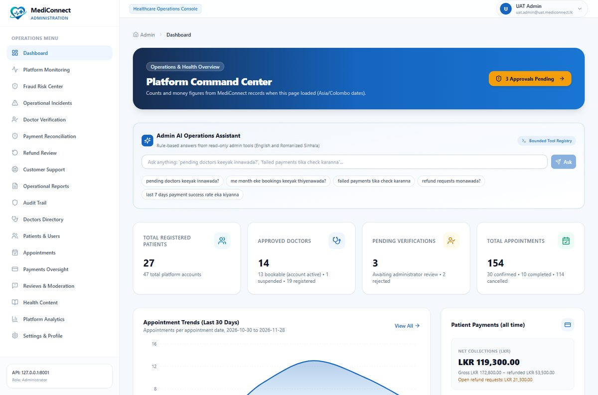 | 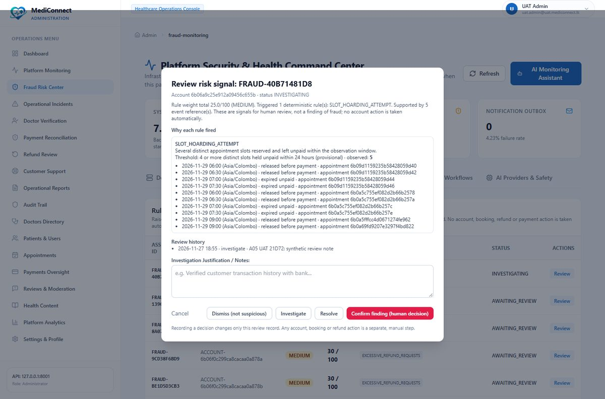 | 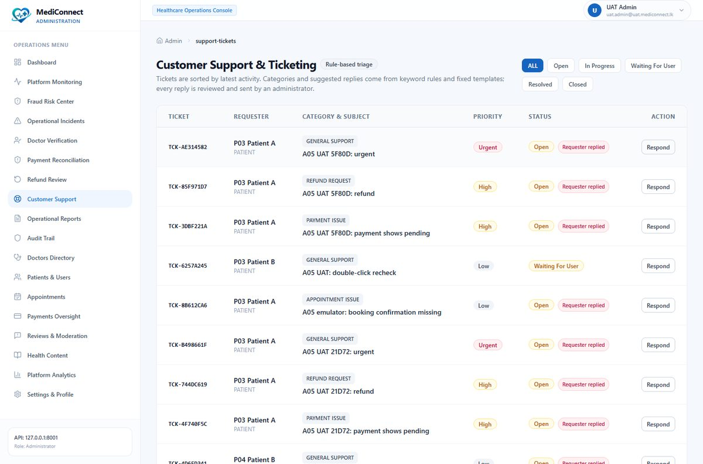 |

## Getting started

Full guide: [Developer setup](docs/DEVELOPER_SETUP.md).

**Requirements:**
- Python 3.12+
- Node.js 20+
- Flutter SDK with Dart ≥ 3.7
- Android SDK and an emulator
- MongoDB on `127.0.0.1:27017`

```powershell
# Backend: isolated local UAT on port 8001 (local mediconnect_uat database, deterministic AI, Stripe test key required)
cd backend; python -m venv venv; .\venv\Scripts\pip install -r requirements.txt
Copy-Item .env.example .env   # placeholders only; fill in your own test keys
powershell -ExecutionPolicy Bypass -File scripts\start_uat_backend.ps1   # first run seeds synthetic UAT data

# Admin web (http://localhost:5173; add "-- --host 127.0.0.1" to keep it local)
cd admin-web; npm ci; npm run dev

# Android app for the emulator (10.0.2.2 is the emulator's alias for the host)
cd mobile; flutter pub get
flutter build apk --debug --dart-define=API_BASE_URL=http://10.0.2.2:8001
```

**Tests:**
- backend: `pytest -q` (uses a local `*_test` database);
- mobile: `flutter analyze` and `flutter test`;
- admin web: `npm run typecheck`, `npm run lint`, `npm test` and `npm run build`.

## Project structure

```text
MediConnect/
├── backend/      FastAPI app (app/routes, app/services, app/agents), tests/, scripts/start_uat_backend.ps1
├── mobile/       Flutter app for patients and doctors (lib/, test/, android/)
├── admin-web/    React + TypeScript admin portal (src/, Vitest tests)
├── docs/         Setup, architecture, UAT reports and evidence (docs/uat/)
└── .github/      CI workflows (backend, mobile, admin web)
```

## Known limitations

- **Clinical:** no clinical validation, no pharmacist review, no validated drug-interaction source, no native-language review of medical wording; medicine image analysis has been tested on synthetic packaging only.
- **Security:** the historical database credential exposure has no rotation evidence, so use a local demonstration only. Provider keys need rotation.
- **Providers:** push, e-mail and SMS are not configured. OpenAI has no credits, and Gemini is on free-tier limits. There is no Stripe staging webhook endpoint.
- **Infrastructure:** single-server local encrypted storage; no backup and restore procedure; no production monitoring or security configuration.
- **Product decisions open:**
  - the doctor consultation fee: there's no entry or edit path, so every doctor uses the LKR 2,500 default (BUG-039);
  - the refund and cancellation policy;
  - fraud thresholds;
  - free-text messaging scope.
- **Devices:** verified on the Android emulator only. No physical phone, physical camera or iOS run.

## Documentation

| Document | Purpose |
|---|---|
| [Developer setup](docs/DEVELOPER_SETUP.md) | Local installation, UAT workflow, tests, optional providers |
| [Architecture overview](docs/ARCHITECTURE_OVERVIEW.md) | System, AI, booking and clinical diagrams |
| [Agentic AI architecture](docs/uat/MEDICONNECT_ADVANCED_AGENTIC_AI_ARCHITECTURE.md) | All 38 components, with evidence |
| [Final engineering summary](docs/uat/MEDICONNECT_FINAL_ENGINEERING_SUMMARY.md) | Phases, results, readiness |
| [Release notes](docs/uat/release-preparation/r04/R04_RELEASE_NOTES.md) | v1.0.0-academic |
| [Owner actions before release](docs/uat/MEDICONNECT_OWNER_ACTIONS_BEFORE_RELEASE.md) | Security, clinical and policy actions |

**Academic use:** this repository is an academic engineering project. It must not be used to diagnose, treat or make decisions about real patients.
