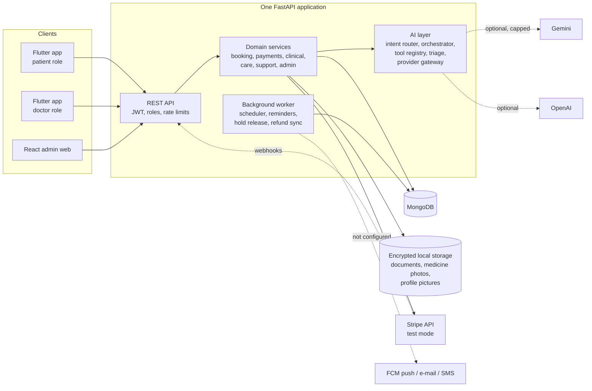
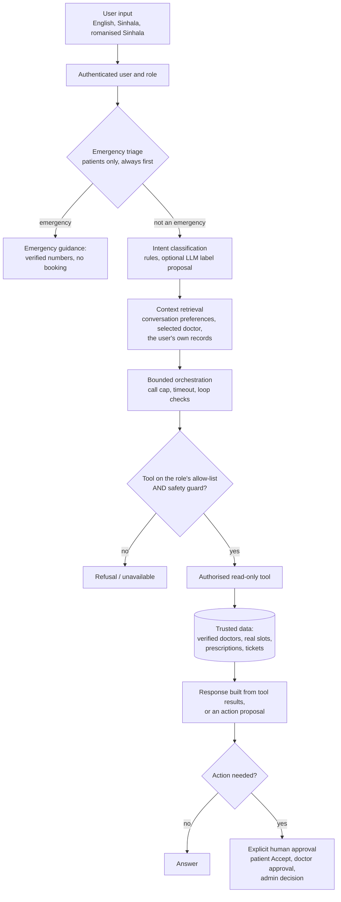
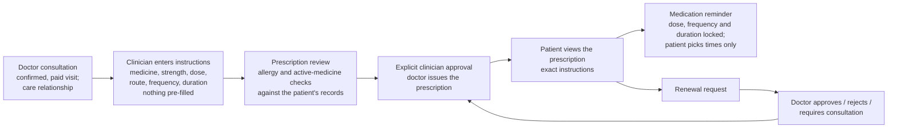

# MediConnect — Architecture Overview

For: technical reviewers and readers of the academic report. v1.0.0-academic (2026-11-28).

Each diagram reflects the implemented code and the verified workflows; there are no microservices or autonomous clinical agents. Component-level detail (all 38 components, entry points, evidence) is in [MEDICONNECT_ADVANCED_AGENTIC_AI_ARCHITECTURE.md](uat/MEDICONNECT_ADVANCED_AGENTIC_AI_ARCHITECTURE.md); the earlier diagrams in [MEDICONNECT_FINAL_ARCHITECTURE.md](uat/MEDICONNECT_FINAL_ARCHITECTURE.md) remain valid.

## 1. System architecture



- **One backend:** a single FastAPI process serves all three clients; the background worker runs inside it.
- **Storage:** MongoDB holds all records. Files are encrypted on local disk (AES-256-GCM) and are never served through public routes.
- **Optional services:** the AI providers are optional. Notifications are stored in the app; external delivery channels are not configured in this release.

## 2. Agentic AI workflow



- **What a model may do:** when a provider is configured, it may propose an intent label, search preferences, a read-only tool call, a rephrasing of a non-authoritative answer, or a reading of a medicine package image. The server validates every proposal.
- **What a model never does:** it never receives other patients' data and never executes a state change. Without a provider, the deterministic engine handles every step.

## 3. Appointment booking workflow

```mermaid
sequenceDiagram
  participant Pt as Patient
  participant AI as AI assistant
  participant DB as Trusted records
  participant S as Stripe (test mode)
  Pt->>AI: "Find me a cardiologist in Colombo"
  AI->>DB: verified doctors (specialty, city)
  AI-->>Pt: doctor cards: real fee, rating only from reviews, picture
  Pt->>AI: "Only under 3000 rupees"
  AI-->>Pt: refined list (specialty and city remembered)
  Pt->>AI: select doctor, ask for tomorrow's slots
  AI->>DB: real free slots
  Pt->>AI: "Book <date> at <time>"
  AI-->>Pt: booking proposal (amount = stored fee); nothing reserved yet
  Pt->>AI: taps Accept & Continue (explicit confirmation)
  AI->>DB: reservation hold (one per slot, timed)
  Pt->>S: Pay Now → PaymentSheet (test card)
  S-->>DB: payment verified (status check or signed webhook)
  DB-->>Pt: appointment CONFIRMED
```

**Safeguards (verified in R03 and A03):**
- An unknown proposal id is refused.
- Another patient cannot accept the proposal or pay for the hold.
- A repeated Accept is idempotent.
- The amount is set by the server.
- An unpaid hold expires and is released.
- The AI's text alone never creates a hold or a charge.

## 4. Clinical workflow



**What is enforced:**
- AI cannot prescribe or change a dose, and it cannot approve renewals.
- Unrelated doctors, other patients and administrators cannot read prescriptions.
- Renewals copy the original instructions exactly.

**What is missing:** no validated drug-interaction source, and no pharmacist or clinical review.
