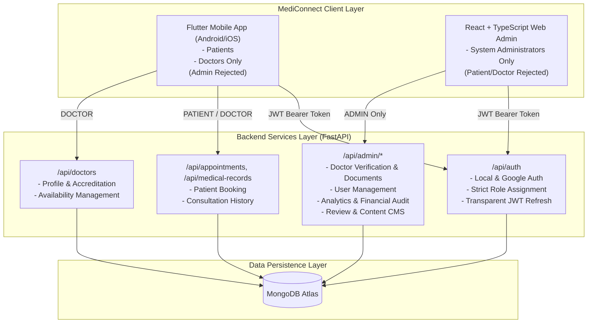

# MediConnect — Phase 32: Flutter Admin Removal & Web-Only Admin Migration

## 1. Executive Summary

In Phase 32, the MediConnect architectural migration has been completed to establish a clean, production-grade separation of client concerns:

1. **Flutter Mobile Application (`mobile/`)**: Exclusively serves **Patients** and **Doctors**. All administrative screens, widgets, providers, and admin-only services have been removed. Any login attempt, session restoration, token refresh, or deep-link navigation targeting an administrator role is rejected with clear, user-friendly guidance.
2. **React + TypeScript Web Admin (`admin-web/`)**: Stands as the **sole, dedicated administrative interface** for MediConnect, providing full feature parity with rich dashboards, doctor credential verification, user administration, review moderation, appointment oversight, payment tracking, and health content publishing.
3. **FastAPI Backend (`backend/`)**: Continues to serve both the mobile application and the web admin portal against the shared MongoDB database, strictly enforcing role-based access control (RBAC) across all endpoints.

---

## 2. Final System Architecture



---

## 3. Features Migrated to Web Admin (`admin-web/`)

The React + TypeScript Web Admin panel provides full administrative functionality:

| Feature Area | Description | Web Admin Component |
| :--- | :--- | :--- |
| **Authentication & RBAC** | Admin login with JWT Bearer tokens, protected routes, auto-redirect on 401 | `src/context/AuthContext.tsx`, `LoginPage.tsx` |
| **Executive Overview** | Real-time analytics, user distribution, monthly revenue, operational metrics | `src/pages/DashboardPage.tsx` |
| **Doctor Verification** | Review application metadata, stream/download SLMC accreditation documents, approve or reject with reason | `src/pages/DoctorVerificationPage.tsx` |
| **Doctor Management** | Browse verified doctors, filter by medical specialty, view status | `src/pages/DoctorsPage.tsx` |
| **User Administration** | Privacy-conscious user directory, status toggle (ACTIVE / SUSPENDED), search | `src/pages/UsersPage.tsx` |
| **Appointments Monitor** | System-wide appointment records, status tracking (PENDING, CONFIRMED, COMPLETED, CANCELLED) | `src/pages/AppointmentsPage.tsx` |
| **Financial Oversight** | Stripe payment audit, gross revenue totals, test vs live mode flags | `src/pages/PaymentsPage.tsx` |
| **Review Moderation** | Moderation queue for flagged reviews, action to restore or hide inappropriate content | `src/pages/ReviewsPage.tsx` |
| **Health Content CMS** | Markdown health article editor, preview tab, tag management, publish/archive lifecycle | `src/pages/ContentPage.tsx` |
| **Analytics Engine** | Appointment trend graphs, doctor specialization charts, revenue breakdowns | `src/pages/AnalyticsPage.tsx` |
| **System Settings** | Platform status monitoring, backend connection healthcheck | `src/pages/SettingsPage.tsx` |

---

## 4. Flutter Mobile Admin Components Removed

The following administrative screens, providers, models, and services were eliminated from the Flutter mobile repository (`mobile/`):

### Removed Files:
- `mobile/lib/screens/admin/admin_dashboard_screen.dart`
- `mobile/lib/screens/admin/doctor_applications_screen.dart`
- `mobile/lib/screens/admin/doctor_application_detail_screen.dart`
- `mobile/lib/screens/admin/document_viewer_screen.dart`
- `mobile/lib/screens/admin/admin_articles_screen.dart`
- `mobile/lib/screens/admin/admin_article_editor_screen.dart`
- `mobile/lib/screens/admin/admin_reviews_screen.dart`
- `mobile/lib/providers/admin_provider.dart`
- `mobile/lib/services/admin_service.dart`
- `mobile/lib/services/analytics_service.dart`
- `mobile/lib/models/admin_doctor_application.dart`

### Preserved Shared Assets:
- Shared models (`user_model.dart`, `health_content.dart`, `doctor_review.dart`) utilized in patient/doctor workflows.
- Shared services (`review_service.dart`, `health_content_service.dart`) serving patient and doctor screens.
- Core network client and security infrastructure (`api_client.dart`, `secure_storage_service.dart`).
- All backend FastAPI admin endpoints (`/api/admin/*`) remain intact for the Web Admin.

---

## 5. Mobile Role Restrictions & Routing Guard

### Mobile Role Rejection Workflow:
1. **Login Validation**: When an administrator attempts to log into the mobile app via email/password or Google Sign-In, the backend validates credentials. Upon recognizing `session.user.role == 'ADMIN'`:
   - Mobile tokens are **not** persisted.
   - Any prior session in secure storage is wiped.
   - The user session is rejected (`_status = AuthStatus.unauthenticated`).
   - A clear notification is presented to the user:
     > *"Admin accounts are supported on the MediConnect Web Admin Portal. Please sign in through the web portal."*
2. **Session Restoration (`checkAuthSession`)**:
   - If an admin JWT exists on startup, `getCurrentUser()` returns role `ADMIN`.
   - The session is rejected, tokens are cleared, and the app redirects to the welcome screen with the informational notice.
3. **Token Refresh Guard**:
   - In `ApiClient._attemptTokenRefresh()`, if the stored user is an Admin, token refresh is rejected and storage is cleared.
4. **Deep-Link & Route Guards**:
   - In `main.dart`, `onGenerateRoute` catches any incoming navigation or deep link starting with `/admin` and routes to `AdminAccessBlockedScreen` with the standard guidance message and a direct action to return to mobile sign-in.

---

## 6. Verification & Test Results

### 1. Flutter Mobile Tests (`mobile/`):
```bash
flutter analyze
# Result: No issues found! (0 warnings, 0 errors)

flutter test
# Result: 177 tests passed! (100% pass rate)
```
- Covered: Admin mobile login rejection, token wiping on rejection, session restoration rejection, route guards for `/admin` deep links, Patient login and home navigation, Doctor login and approval-dependent navigation, and logout session teardown.

### 2. React Admin Web Tests (`admin-web/`):
```bash
npm run lint
# Result: 0 errors, 0 warnings

npm run typecheck
# Result: 0 TypeScript errors

npm run test -- --run
# Result: 14 tests passed! (4 test suites)

npm run build
# Result: Production bundle built cleanly (dist/)
```

### 3. FastAPI Backend Tests (`backend/`):
```bash
python -m compileall app
# Result: Compiled with 0 syntax or import errors

python -m pytest backend/tests/test_phase32_migration_regression.py
# Result: 1 passed! (RBAC, unauthenticated denial, patient/doctor cross-role access rejection, medical record privacy)

python -m pytest backend/tests/test_admin_web_endpoints.py
# Result: 1 passed! (All Web Admin backend CRUD and monitoring endpoints)
```

---

## 7. Local Development Guide

### Running Web Admin:
```powershell
cd C:\Users\REDTECH\Downloads\MediConnect\admin-web
npm install
npm run dev
# Accessible at: http://localhost:5173
```

### Running Backend:
```powershell
cd C:\Users\REDTECH\Downloads\MediConnect\backend
.\venv\Scripts\activate
uvicorn app.main:app --reload --host 0.0.0.0 --port 8000
# API documentation: http://localhost:8000/docs
```

### Running Mobile App (Android/iOS):
```powershell
cd C:\Users\REDTECH\Downloads\MediConnect\mobile
flutter pub get
flutter run
```

---

## 8. Deployment & Security Considerations

- **Frontend Isolation**: Mobile role restrictions improve user experience but do not substitute backend authorization. Backend endpoints strictly enforce `require_admin` dependency checks on every administrative route.
- **Production URL Protection**: Portal URLs are not hardcoded with assumptions; administrative operations are isolated to the authorized Web Admin origin.
- **Secret Hygiene**: No JWT secrets, MongoDB credentials, or private keys are exposed or committed in frontend repositories.
