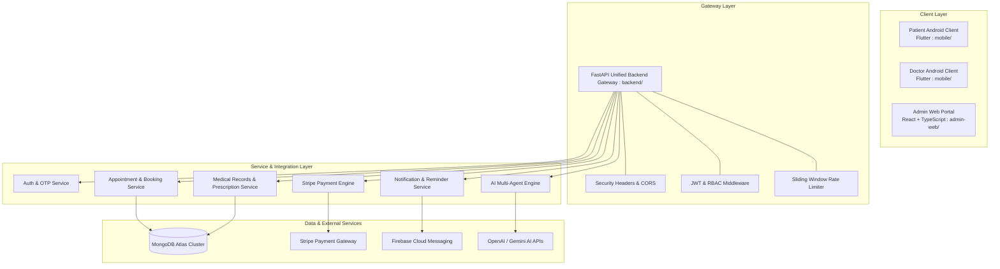
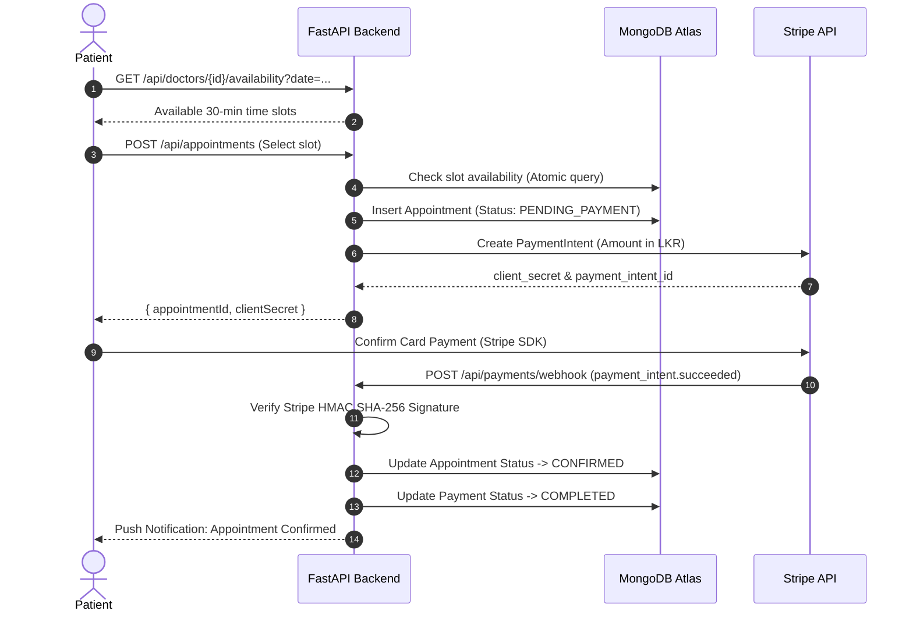
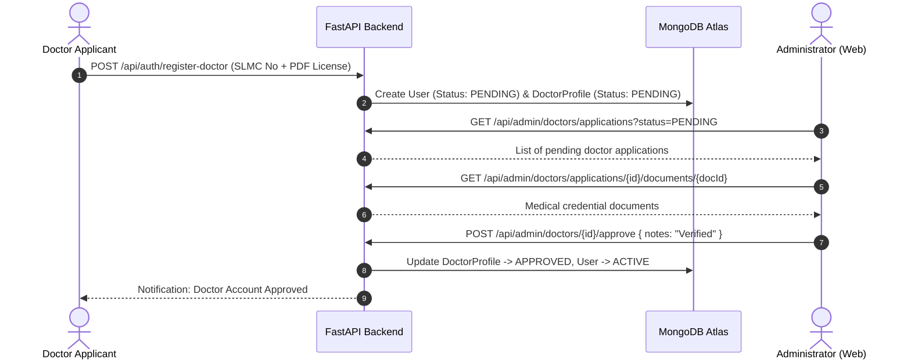

# MediConnect — System Architecture & Design Specification

- **Version:** 1.0.0
- **Document Status:** Final Architecture Baseline
- **Audience:** Core Engineers, Solution Architects, Security Auditors, DevOps

---

## 1. High-Level Architecture Overview

MediConnect implements a clean three-tier architecture that enforces strict role-based client separation, shared API gateway governance, and isolated data storage:



---

## 2. Client Role Partitioning

The MediConnect system guarantees strict platform isolation:

| Platform | Target Audience | Primary Responsibilities | Prohibited Features |
| :--- | :--- | :--- | :--- |
| **Flutter Mobile (`mobile/`)** | Patients & Doctors | Doctor discovery, slot booking, Stripe payments, prescriptions, reminders, consultations | **Zero administrative features**. Admin login, user management, and verification screens are excluded. |
| **React Web Admin (`admin-web/`)** | System Administrators | Doctor verification, user directory oversight, financial tracking, review moderation, content publishing | **Zero patient or doctor features**. Cannot book appointments or view clinical notes. |

---

## 3. Authentication & Session Architecture

### A. JWT Specification & Claims
- **Signature Algorithm**: HMAC SHA-256 (`HS256`).
- **Minimum Secret Length**: 32 bytes (256 bits) enforced in production mode at server startup.
- **Payload Schema**:
  ```json
  {
    "sub": "user_object_id_string",
    "role": "PATIENT | DOCTOR | ADMIN",
    "type": "access | refresh",
    "iat": 1700000000,
    "exp": 1700003600
  }
  ```
- **Access Token Expiry**: 60 minutes (`ACCESS_TOKEN_EXPIRE_MINUTES = 60`).
- **Refresh Token Expiry**: 7 days (`REFRESH_TOKEN_EXPIRE_DAYS = 7`).
- **Storage**:
  - React Admin: `sessionStorage` (`mediconnect_admin_token`, `mediconnect_admin_user`).
  - Flutter Mobile: `SharedPreferences` / Encrypted Storage.

### B. Role-Based Access Control (RBAC) Matrix
Authorization is enforced independently by FastAPI route dependencies regardless of frontend checks:

| API Domain | Path Prefix | Required Role Dependency | Unauthorized Action |
| :--- | :--- | :--- | :--- |
| **Public Auth** | `/api/auth/register`, `/api/auth/login` | None (Public) | None |
| **Patient Profile** | `/api/auth/me`, `/api/appointments/me` | `require_patient` | HTTP 403 Forbidden |
| **Doctor Availability**| `/api/doctors/me/availability` | `require_verified_doctor` | HTTP 403 Forbidden |
| **Doctor Consultations**| `/api/doctors/me/appointments` | `require_verified_doctor` | HTTP 403 Forbidden |
| **Admin Doctor Approval**| `/api/admin/doctors/{id}/approve` | `require_admin` | HTTP 403 Forbidden |
| **Admin User Mgmt** | `/api/admin/users` | `require_admin` | HTTP 403 Forbidden |
| **Admin Analytics** | `/api/admin/analytics/*` | `require_admin` | HTTP 403 Forbidden |
| **Medical Records** | `/api/medical-records/{id}` | Patient or Treating Doctor | HTTP 403 Forbidden |

---

## 4. End-to-End Business Workflows

### A. Appointment Booking & Stripe Payment Workflow


### B. Doctor Onboarding & Verification Workflow


### C. Medical Records & Digital Prescription Lifecycle
1. **Appointment Completion**: Doctor marks appointment as `COMPLETED`.
2. **Consultation Record Creation**: Doctor submits `POST /api/medical-records` containing clinical notes, diagnosis, and treatment plans.
3. **Digital Prescription**: Doctor invokes `POST /api/prescriptions` with structured medication items, dosages, duration, and instructions.
4. **IDOR Defense**: When Patient requests `GET /api/prescriptions/{id}/pdf`, the service verifies `patientUserId == authenticated_user_id`. Cross-patient access attempts return HTTP 403.
5. **Medication Tracking**: Patient converts prescription items into daily reminder schedules (`/api/medication-reminders`).

---

## 5. Third-Party Integrations & Safeguards

### A. Stripe Test Payments
- **Test Mode Enforcement**: `STRIPE_SECRET_KEY` is checked in code and in CI to start with `sk_test_`.
- **Webhook Security**: All webhook requests must pass `stripe.Webhook.construct_event()` with `STRIPE_WEBHOOK_SECRET`. Unsigned requests return HTTP 400.
- **Idempotency**: Webhook events check for existing transaction IDs in the `payments` collection before triggering state changes.

### B. Firebase Cloud Messaging (FCM)
- **Token Registration**: Mobile clients submit device tokens on startup.
- **Cross-Account Protection**: If a device is shared, registering a token deletes prior user associations.
- **Payload Privacy**: Push notifications do not contain clinical diagnoses or drug names; alerts use generic text instructing users to authenticate in-app.

### C. AI Multi-Agent Services
- **Doctor Recommendations**: Symptom-based doctor matching engine (`/api/ai/doctor-recommendations`).
- **Booking Assistant**: Conversational agent assisting patients in selecting specialties, doctors, and available slots (`/api/ai/booking/sessions`).
- **Health Assistant**: General health advice chat with prominent medical disclaimers (`/api/ai/health-chat/sessions`).
- **Safeguards**:
  - All AI endpoints include prominent medical disclaimers.
  - Booking assistant requires explicit patient confirmation before creating any reservation.
  - Doctor and Admin roles are blocked from patient AI assistants (HTTP 403).

---

## 6. Database Schema & Index Design

MongoDB Atlas collections utilize automated idempotent index creation on startup (`ensure_indexes()`):

| Collection | Key Fields | Indexes Enforced |
| :--- | :--- | :--- |
| `users` | `_id`, `email`, `role`, `accountStatus` | Unique index on `email` |
| `doctor_profiles` | `userId`, `doctorId`, `verificationStatus` | Unique on `userId`, unique on `doctorId`, unique on `medicalRegistrationNumber` |
| `doctor_availabilities` | `doctorUserId`, `date`, `startTime`, `isActive`| Compound index on `(doctorUserId, date, startTime)` |
| `appointments` | `patientUserId`, `doctorUserId`, `date`, `startTime` | Compound unique index preventing overlapping active bookings |
| `payments` | `paymentIntentId`, `appointmentId`, `status` | Unique index on `paymentIntentId` for webhook idempotency |
| `medical_records` | `recordId`, `patientUserId`, `doctorUserId` | Unique on `recordId`, index on `patientUserId` |
| `prescriptions` | `prescriptionId`, `medicalRecordId`, `patientUserId`| Unique on `prescriptionId`, index on `patientUserId` |
| `tokens` | `userId`, `refreshToken`, `expiresAt` | TTL index on `expiresAt` for automatic cleanup |
| `health_content` | `slug`, `status`, `publishedAt`, `tags` | Unique on `slug`, text index on `title, body, tags` |
