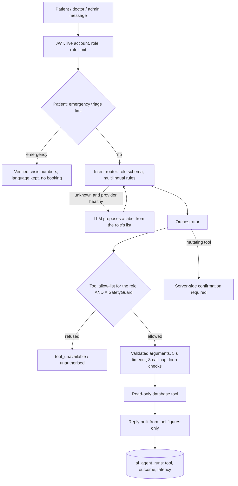

# MediConnect — Agentic AI Architecture (evidence-based, R03)

For: reviewers, the academic report, the README and the planned demonstration. 2026-11-28, code at `fix/final-release-verification` (`4f64295`, from `main` `b20e683`). Every statement here points to code or to recorded verification. Nothing is described as live generative AI unless it was run against a live provider.

## 1. In one paragraph

MediConnect is a **hybrid agentic system**. A small number of components may use a large language model (LLM) for language understanding or image reading. Every such use is **bounded**:
- the model can propose labels, search preferences, read-only tool calls or an image reading;
- the server validates every proposal against schemas, role allow-lists and trusted database records;
- the model never receives other patients' data and never executes an action.

Critical clinical and financial actions are deterministic and human-controlled: booking confirmation, payment, refunds, prescriptions, note signing, approvals and account actions. Each LLM path has a deterministic fallback, and the whole platform runs with no provider configured (the UAT default). **Of the 38 components, 7 have an optional bounded LLM path; 31 are deterministic.** They are not 38 autonomous LLM agents.

## 2. Component classes

| Class | Meaning | Components |
|---|---|---|
| **LLM-assisted agent** | A model performs a core reading or wording step; the server validates the output and falls back deterministically | 02 Health Assistant, 04 Medicine Image Analysis |
| **Hybrid AI agent** | Deterministic search, ranking and state machine; a model may propose preferences or read-only tool calls | 01 Appointment Booking Agent, 03 Doctor Recommendation |
| **Deterministic workflow assistant** | Role-checked tools and templates that help a person complete a workflow; no model | 06, 11, 12, 14, 15, 16, 17, 18, 19, 20, 21, 22, 23, 26, 30 |
| **Rule-based automation service** | Scheduled or event-driven rules; no model | 05, 07, 08, 09, 10, 13, 24, 25, 27, 28, 29, 36, 38 |
| **Shared AI infrastructure** | Orchestration, providers, intent, triage, memory, safety | 31, 32, 33 (bounded LLM paths), 34, 35, 37 (deterministic) |

Totals: 2 + 2 + 15 + 13 + 6 = **38**.

## 3. Request path

Text: every message is authenticated and rate-limited. Patient messages go through emergency triage first. The intent router labels the request; a model may only propose a label from the role's list when the rules are unsure. The orchestrator runs only tools on the role's allow-list that also pass the safety guard, with validated arguments and bounded calls. Replies use only tool results. Every run is recorded.

## 4. The 38 components

Legend:
- **Provider:** "—" means no model; "bounded" means optional and validated.
- **Approval:** the human step that the component can never bypass.
- **Status:** final R03 status; evidence and limitations per component are in `MEDICONNECT_FINAL_38_COMPONENT_VERIFICATION_MATRIX.md`.

### Patient

| ID | Name | Class | Implementation / entry point | Trusted data | Tools and authorisation | Human approval | Provider | Fallback | Status |
|---|---|---|---|---|---|---|---|---|---|
| 01 | Appointment Booking Agent | Hybrid | `agents/booking_agent.py`, `services/booking_session_service.py`; `POST /api/ai/conversations/{id}/messages`, `POST /api/ai/booking/sessions/{id}/confirm` | `doctor_profiles` (approved), availability, appointments | Public read-only search tools; patient-only; proposal owner only | Explicit Accept before a hold; payment only through Stripe | Bounded (preferences, read-only tool picks) | Deterministic NLP parser | VERIFIED |
| 02 | Health Assistant | LLM-assisted | `agents/health_assistant_agent.py`; `/api/ai/health-chat`, unified conversations | Medicine and wellness libraries, patient's own records | Patient-only, own data | — (no clinical action possible) | Bounded (rephrasing of non-authoritative answers only) | Grounded deterministic composer | VERIFIED · clinical review |
| 03 | Doctor Recommendation | Hybrid | `agents/recommendation_engine.py`, `agents/doctor_ranking.py`; `/api/ai/recommendations`, assistant search | `doctor_profiles`, reviews | Read-only | — | Bounded (preference proposal) | Deterministic ranking | VERIFIED |
| 04 | Medicine Image Analysis | LLM-assisted | `agents/medicine_image_agent.py`; `POST /api/ai/booking/sessions/{id}/image` | Encrypted uploaded image, medicine library | Patient-only | — (information only, never dosing) | Vision model, strict schema | Refusal rules (blurry, loose tablets, several packages) | PARTIAL |
| 05 | Medication Reminder | Rule-based | `services/medication_reminder_service.py`, `services/care_scheduler.py`; `/api/medication-reminders`, `/api/care-automation/prescriptions/{id}/schedule` | Issued prescriptions | Patient sets times only; dose and duration fixed | Clinician-approved schedules | — | n/a | PARTIAL |
| 06 | Care Plan Assistant | Deterministic | `services/care_plan_service.py`; `/api/care-plans` | Care plans | Author doctor edits; patient reads | Doctor authors | — | n/a | VERIFIED · clinical review |
| 07 | Appointment Reminder | Rule-based | `services/care_scheduler.py` (worker) | Confirmed, paid appointments | — | — | — | n/a | PARTIAL |
| 08 | Follow-up Reminder | Rule-based | `services/care_scheduler.py` | Care plans | — | Plan author | — | n/a | PARTIAL |
| 09 | Medical Test Reminder | Rule-based | `services/care_scheduler.py` | Care-plan test tasks | — | Clinician instructions verbatim | — | n/a | PARTIAL |
| 10 | Health Tracking | Rule-based | `services/health_tracking_service.py`; `/api/care-automation/measurements`, `/api/clinical/measurements` | Patient measurements | Owner or treating doctor | — | — | n/a | VERIFIED · clinical review |
| 11 | Prescription Renewal | Deterministic | `services/prescription_workflow_service.py`; `/api/clinical/prescriptions/renewals` | Prescriptions | Patient requests; prescribing doctor decides | Doctor approval | — | n/a | VERIFIED · pharmacist review |
| 12 | Medical Records Assistant | Deterministic | `services/medical_record_service.py`, `services/document_crypto.py`; `/api/medical-records` | Encrypted records | Owner and care relationship; admin denied | — | — | n/a | VERIFIED |
| 13 | Notification Assistant | Rule-based | `services/notification_service.py`; `/api/notifications` | Notification store | Recipient only | — | — | n/a | PARTIAL |

### Doctor

| ID | Name | Class | Implementation / entry point | Trusted data | Tools and authorisation | Human approval | Provider | Fallback | Status |
|---|---|---|---|---|---|---|---|---|---|
| 14 | Doctor Schedule Assistant | Deterministic | `routes/doctor_schedule.py`; `/api/doctor` | Availability, leave, blocks | Own schedule | Doctor | — | n/a | VERIFIED |
| 15 | Consultation Preparation | Deterministic | `services/doctor_workflow.py`; `/api/doctor/workflow/preparation/{id}` | Own and authorised shared records | Care relationship | — (no diagnosis) | — | n/a | VERIFIED · clinical review |
| 16 | Clinical Notes Assistant | Deterministic | `services/clinical_documentation_service.py`; `/api/clinical` | Consultation data | Treating doctor | Doctor signs (single signature) | — | n/a | VERIFIED · clinical review |
| 17 | Prescription Assistant | Deterministic | `agents/prescription_assistant.py`; `/api/clinical/prescriptions/assistant-review` | Allergies, active medicines | Doctor; role-checked tools | Doctor issues; nothing pre-filled | — | n/a | PARTIAL |
| 18 | Follow-up Care Generator | Deterministic | `services/doctor_workflow.py` | Consultation | Treating doctor | Doctor reviews before saving | — | n/a | VERIFIED |
| 19 | Patient Communication | Deterministic | `services/doctor_communications.py`; `/api/doctor/workflow` | Fixed templates | HMAC approval token | Doctor approves each message | — | n/a | PARTIAL |
| 20 | Appointment Queue Manager | Deterministic | `services/doctor_workflow.py`; `/api/doctor/workflow/queue` | Own appointments | Owner doctor | — | — | n/a | VERIFIED |
| 21 | Doctor Analytics | Deterministic | `services/analytics_service.py`, `services/financial_metrics.py` | Appointments, payments | Own figures | — | — | n/a | VERIFIED |

### Admin

| ID | Name | Class | Implementation / entry point | Trusted data | Tools and authorisation | Human approval | Provider | Fallback | Status |
|---|---|---|---|---|---|---|---|---|---|
| 22 | Doctor Verification Assistant | Deterministic | `services/doctor_verification_assistant.py`; `/api/admin/workflow/doctor-verification/{id}/ai-review` | Application, documents (audited views) | Admin | Admin approves or rejects; registry check manual | — | n/a | VERIFIED |
| 23 | Platform Analytics | Deterministic | `services/admin_analytics_assistant.py`; `/api/admin/analytics`, `/api/admin/workflow/assistant` | Aggregates | Admin; read-only tools | — | — | n/a | VERIFIED |
| 24 | Payment Monitoring | Rule-based | `services/payment_monitoring_service.py` | Payments, Stripe states | Admin | Review, never auto-confirm | — | n/a | VERIFIED |
| 25 | Fraud Detection | Rule-based | `services/fraud_detection_service.py`; `/api/security/fraud/assessments` | Holds, payments, security events | Admin | Signals only; admin reviews; no account action | — | n/a | VERIFIED · thresholds provisional |
| 26 | Customer Support | Deterministic | `agents/support_assistant.py`, `services/support_ticket_service.py` | Tickets | Requester or admin | Admin sends every reply | — | n/a | VERIFIED |
| 27 | Refund Management | Rule-based | `services/refund_service.py`; `/api/admin/workflow/refunds` | Payments, policy amounts | Admin | Admin approval; atomic, idempotent | — | n/a | VERIFIED |
| 28 | System Monitoring | Rule-based | `services/platform_monitoring_service.py`; `/api/security/monitoring/platform` | Measured states | Admin | — | — | n/a | VERIFIED |
| 29 | Notification Monitoring | Rule-based | `services/notification_monitoring_service.py`; `/api/security/monitoring/notifications` | Outbox and reminder states | Admin | Manual retry | — | n/a | VERIFIED |
| 30 | Report Generation | Deterministic | `services/admin_report_service.py`; `/api/admin/workflow/reports` | Report metrics | Admin; exports audited | — | — | n/a | VERIFIED |

### Shared

| ID | Name | Class | Implementation / entry point | Trusted data | Tools and authorisation | Human approval | Provider | Fallback | Status |
|---|---|---|---|---|---|---|---|---|---|
| 31 | Agent Orchestrator | Shared (bounded LLM) | `agents/orchestrator.py`, `agents/tool_registry.py` (52 tools, one mutating) | Tool results | Role allow-lists + safety guard | Mutating tool needs server confirmation | Bounded tool rounds | Deterministic routing | VERIFIED |
| 32 | AI Provider Management | Shared (bounded LLM) | `agents/provider_gateway.py`, `agents/ai_provider.py`, `agents/llm_client.py` | — | Header-only keys; daily caps; circuit breaker | — | Gemini primary, OpenAI secondary | Deterministic engine | PARTIAL |
| 33 | Intent Classification | Shared (bounded LLM) | `agents/intent_router.py`, `agents/intent_proposal.py`, `agents/clinical_intent.py`, `agents/companion_intent.py` | Role schemas | Labels only | — | Bounded label proposal | Rules | VERIFIED · language review |
| 34 | Emergency Triage | Shared | `agents/emergency_detector.py` | Verified numbers (1990, 1926, 1333) | — | Dialer only after user confirmation | — | n/a | VERIFIED · clinical review |
| 35 | Conversation Memory | Shared | `services/booking_session_service.py` (structured preferences) | Owner's conversation | Owner only (cross-account 404) | — | — | n/a | VERIFIED |
| 36 | Scheduler | Rule-based | `services/care_scheduler.py` | Sources re-checked before delivery | Leases, deterministic ids | — | — | n/a | VERIFIED |
| 37 | Safety and Permission Guard | Shared | `services/ai_safety_guard.py`, `services/clinical_safety_service.py` | Roles, care relationships | Tool and HTTP authorisation | — | — | n/a | VERIFIED |
| 38 | Workflow Monitoring and Recovery | Rule-based | `services/workflow_monitoring_service.py` | Run records, pending refunds | Admin | No blind financial retries | — | n/a | VERIFIED |

## 5. Agentic capabilities, verified

| Capability | Where | Evidence (latest) |
|---|---|---|
| Orchestration with bounded tool calling | 31 | P05 `arch` S-01a–h; R03 A04/A05 probe re-runs (tool, outcome recorded) |
| Intent classification | 33 | P05 `int` (45 tests); R03 probe: support, prescription, medication-change and emergency intents labelled correctly |
| Contextual conversation memory | 35, 01 | R03 A02: adding a fee limit kept specialty and city; owner-only access |
| Validated tool calling | 31, 37 | Allow-lists, argument schemas, 8-call cap, mutating tool needs confirmation (P05) |
| Trusted backend retrieval | 01, 03, 17, 26 | R03 A01/A07: cards and amounts equal stored records; prescriptions verbatim |
| Multi-step workflow assistance | 01 | R03 A01–A09: search → refine → select → slots → proposal → explicit Accept → hold |
| Multilingual understanding | 01, 02, 33, 34 | A03 probe re-run: English, Sinhala, romanised and mixed threads (deterministic engine) |
| Multimodal image analysis | 04 | A01 live Gemini vision on 8 synthetic images; not live in R03 (disabled in UAT) |
| Human-in-the-loop execution | 01, 11, 16, 17, 19, 22, 25, 26, 27 | R03: explicit Accept (A06), renewal approval on device, admin-only replies and refunds, fraud signals without action |
| Provider fallback | 32 | A01 live: invalid key, invalid model, quota, OpenAI→Gemini fallback, both unavailable → deterministic |
| Role-based tool authorisation | 31, 37 | R03 `SEC` and probe refusals (patient/doctor → admin 403; other patient 403/404) |
| Prompt-injection resistance | 37, 31 | R03 S08: injection got a neutral reply, no data, no action; P05 `sec` |

## 6. What is not claimed

- No component has clinical, pharmacist or regulatory approval.
- Live LLM verification exists only for 02, 04 and 32, with Gemini and synthetic data (A01). OpenAI live generation was never run (no credits). R03 made no live provider calls.
- Fraud thresholds are provisional engineering defaults with no measured false-positive rate.
- Physical phones, iOS, push, e-mail and SMS delivery are unverified.
- Profile pictures are display-only: no biometric identification, health inference or facial analysis.
