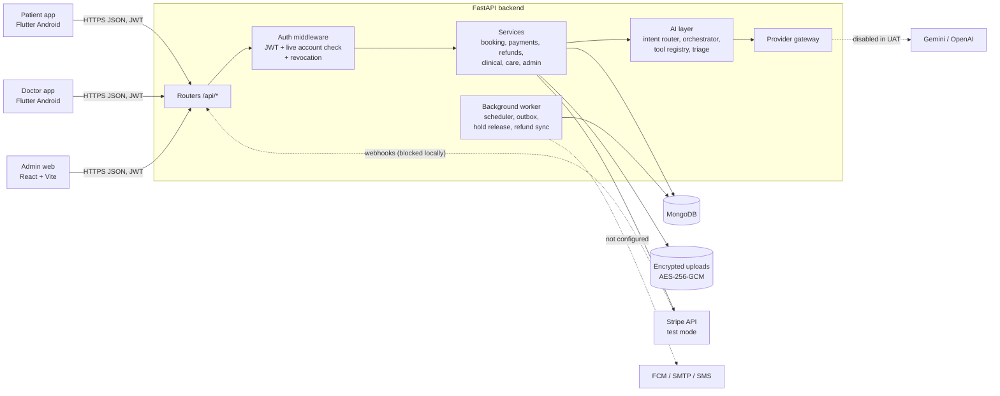
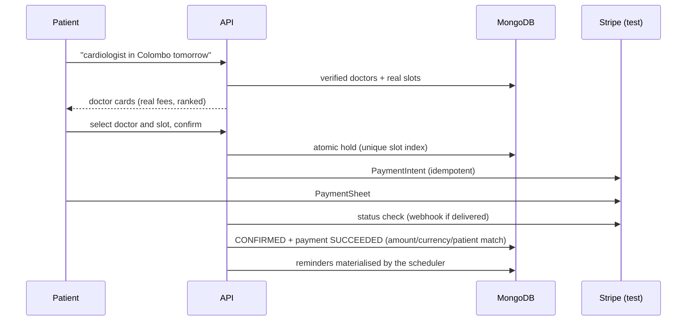
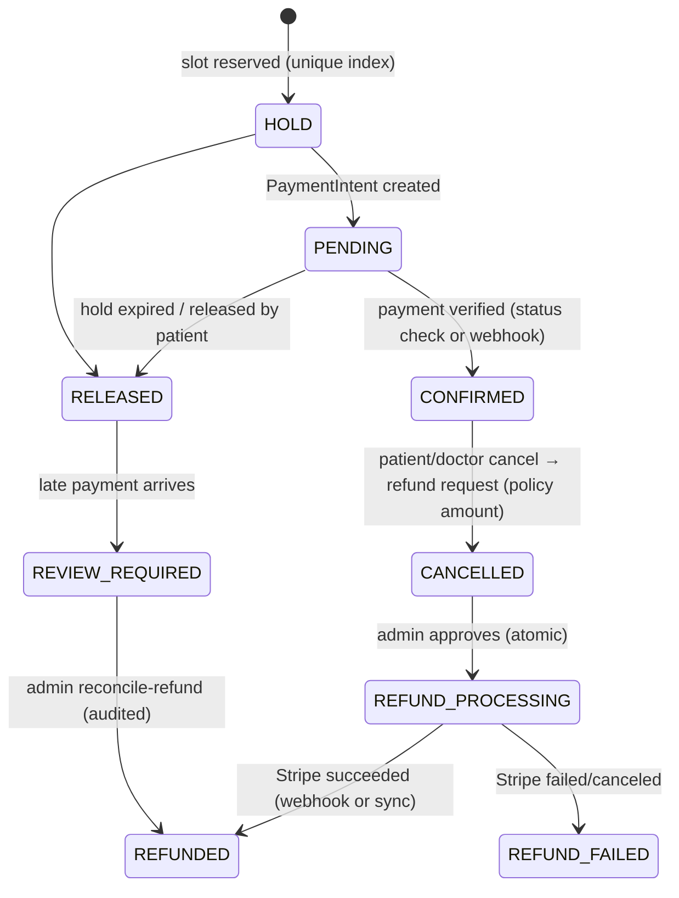
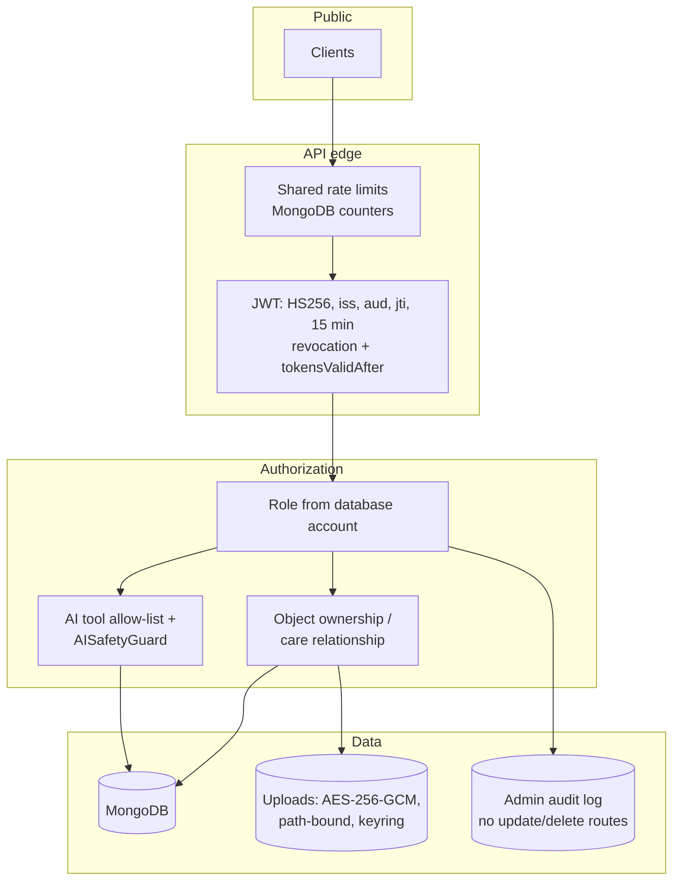

# MediConnect — Final Architecture (as implemented, 2026-11-26)

For: engineers, reviewers and the owner. Describes the code on `fix/phase-05-final-ai-security-integration` (`74fc231`). Diagrams are Mermaid; each has a text description.

## 1. Overall system



- **Clients:**
  - The Flutter app serves patients and doctors, by role.
  - The React admin web is for administrators.
  - Both send short-lived JWTs (15 minutes by default) and refresh them single-flight.
- **Backend:** one FastAPI application. The background worker runs inside the API process: reminders, booking-confirmation outbox, doctor communications, hold release and the pending-refund sync.
- **Storage:**
  - MongoDB holds all records.
  - Uploaded documents sit on local disk, encrypted with keys from the environment.
- **External services:** Stripe (test mode verified); Gemini/OpenAI, FCM, SMTP and SMS are not configured in UAT.

## 2. AI orchestration

```mermaid
flowchart TD
  U[Message] --> AUTH[JWT + role + rate limit]
  AUTH --> EM{Patient:\nemergency?}
  EM -- yes --> ER[Emergency reply\n1990 / crisis lines,\nlanguage kept]
  EM -- no --> IR[Intent router\nrole schema, multilingual]
  IR -- unknown + provider healthy --> LP[LLM proposes a label\nfrom the role's list]
  LP --> IR
  IR -- ambiguous --> ASK[Ask which topic]
  IR --> OR[Orchestrator.execute]
  OR --> CHK{allow-list AND role\nAND AISafetyGuard?}
  CHK -- no --> X[tool_unavailable / unauthorized]
  CHK -- yes --> VAL[pydantic args\n5 s timeout, 8-call cap,\nduplicate + loop checks,\nmutating ⇒ confirmation]
  VAL --> T[Read-only tool\n(database query)]
  T --> RES[Bounded JSON result]
  RES --> REP[Template reply from\ntool figures only]
  OR --> RUNS[(ai_agent_runs:\ntool, outcome, ms)]
```

- **Tool registry:** 52 tools; exactly one changes state (a patient renewal request), and it requires server-side confirmation.
- **LLM role:**
  - An LLM may propose an intent label, search preferences, or read-only doctor-search tool calls.
  - It never receives account data or other patients' data, and never executes anything.

## 3. Patient workflows



Other patient paths:
- care agenda (medication, tests, follow-ups);
- renewal requests;
- encrypted record uploads;
- measurements from either entry point;
- emergency triage first on every message.

## 4. Doctor workflows

```mermaid
flowchart LR
  Q[Queue / schedule] --> PREP[Consultation preparation\nown records + authorized shared sources\n+ missing-information list]
  PREP --> CONS[Consultation start/complete\nconfirmed paid visits only]
  CONS --> NOTE[Clinical note draft\nNOT_DOCUMENTED placeholders]
  NOTE --> SIGN[Doctor signs\n(single signature)]
  CONS --> RX[Prescription signed by doctor]
  RX --> MED[Medication schedule\nclinician-approved times]
  CONS --> CP[Care plan\nversion-checked updates]
  REN[Renewal queue] --> DEC[Doctor decision\none prescription per approval]
```

Access to patient data always needs a care relationship: an approved, active doctor with a confirmed or completed visit.

## 5. Admin workflows

```mermaid
flowchart LR
  V[Doctor verification\ndocuments decrypted in memory,\nevery view audited] --> APR[Approve / reject\naudited]
  REF[Refund queue] --> APP[Approve: atomic claim\n→ Stripe refund (idempotent)\n→ audited]
  APP --> WH[Webhook / polling\nfinal state, never downgraded]
  MON[Monitoring\nmeasured states only] --> AIRUN[AI runs, providers,\nworkers, notifications]
  REP[Reports / CSV\nescaped, audited]
  ASST[Admin assistant\nintent → read-only tool]
```

## 6. Booking and payment lifecycle



## 7. Reminder scheduler

- **Occurrences** are computed from sources: confirmed appointments (24 h and 2 h before), care plans and tasks, approved medication schedules, and tracking schedules. Asia/Colombo dates are used throughout.
- **Deterministic event IDs** (a hash of source, kind, time, version and suffix) mean an upsert can never create a duplicate.
- **Atomic claim:** `pending` becomes `sending` with a lease (on the run's clock). An expired lease becomes `uncertain` and is never re-sent automatically.
- **Channels:**
  - in-app (idempotency key);
  - push (FCM);
  - e-mail and SMS (opt-in).
  - Unconfigured channels are recorded as failed or skipped, never as delivered.
- **Cancellation and time changes:** the current source is re-checked before delivery, so obsolete reminders are cancelled.

## 8. Security and privacy boundaries



**Configuration gates (start-up):**
- `ENVIRONMENT` must be valid.
- A remote database is allowed only in staging/production or when deliberately enabled.
- Strong JWT secret required.
- Document keys required in production.
- No live Stripe key outside production.

**Not enforced by the application** (deployment responsibilities):
- TLS termination;
- disk and database encryption;
- backups;
- secret storage;
- network access lists.
