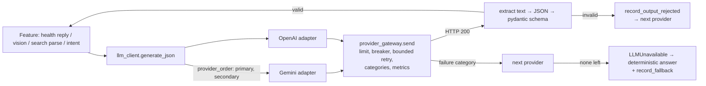

# A01 — AI Provider Verification (Component 32)

For: the project owner and engineers. 2026-11-26, branch `fix/agents-a01-ai-intelligence-vision`.

## Authorization and limits

- **Authorization:** the owner authorized live requests on 2026-11-26 ("Yes, capped"), using the keys already in `backend/.env`.
  - **Data:** synthetic text and generated synthetic packaging images only. No patient data, prescription or document was sent.
  - **Cap:** about 80 text and 30 vision requests per provider. The UAT backend enforced it with `AI_DAILY_REQUEST_LIMIT=150`.
  - **Billing:** no billing settings were changed and no subscription was created.
- **Key exposure:** both keys are still pending rotation (P4-B2). Using them for these tests does not change their exposure status.

## Model identifiers (checked 2026-11-26)

| Provider | Configured before | Status of that id | Now used | How verified |
|---|---|---|---|---|
| Gemini | `gemini-1.5-flash` (`backend/.env`); Phase 05 remapped it to `gemini-flash-latest` | **Shut down** (`GET models/gemini-1.5-flash` → 404). The docs no longer state the alias target. | Default **`gemini-3.8-flash`** (stable, GA 2026-09-02, image input, structured output). Retired ids are remapped and reported. | Official Gemini models and deprecations pages; `GET models/gemini-3.8-flash` → 200 (`generateContent` supported, `thinking: true`) |
| Gemini (live tests) | — | — | **`gemini-3.5-flash-lite`** (stable, GA 2026-07-21, image input, structured output), set per run with `-GeminiModel` | `gemini-3.8-flash`'s free-tier daily quota (20 generate requests/day) ran out during A01; the free-tier quota is per model. |
| OpenAI | `gpt-4o-mini` | Works, but **shutdown 2027-01-14** (`GET models/gpt-4o-mini` → `shutdown_date: 2027-01-14`). Official replacement: `gpt-6-luna`. | Default **`gpt-6-luna`** (Chat Completions, image input, structured outputs; reasoning family → no custom temperature, `reasoning_effort=low`) | Official deprecations and model pages; `GET models/gpt-6-luna` → 200, `shutdown_date: null` |

`backend/.env` was not edited:
- The UAT launcher pins the new ids for each process.
- Provider status reports `modelRemapped` and `modelShutdownDate`.
- `.env.example` documents the new defaults.

## Architecture after A01

- **One interface.** Both adapters take `(system, user, optional image, JSON schema)` and return JSON text. Credentials travel only in headers.
- **Provider order.** `AI_PRIMARY_PROVIDER` / `AI_SECONDARY_PROVIDER` set the order. A provider without a key is skipped, and `none` disables a slot. Tool calling stays on one provider for the whole run.
- **Capability-aware models.** `GEMINI_VISION_MODEL` / `OPENAI_VISION_MODEL` are optional. A model outside the vision-capable families is skipped for images (`capability_unsupported`).
- **Validated structured output.**
  - Gemini: `responseMimeType` + `responseJsonSchema`. OpenAI: `json_schema` with `strict: true`.
  - The answer is then validated again with pydantic.
  - A blocked, truncated, prose, non-JSON or schema-invalid answer is rejected, counted as a failure, and the next provider is tried.
- **Bounded retries.** At most one retry, only for transient 429 and 5xx responses and connection errors, after a 0.5 s back-off (`Retry-After` honoured up to 2 s). A timeout, an authentication failure, an invalid model or an exhausted quota is never retried.
- **Failure categories:** `auth_failed` (401, 403, Gemini 400 `API_KEY_INVALID`), `invalid_model`, `rate_limited`, `quota_exhausted` (OpenAI `insufficient_quota`, Gemini "per day" quota), `timeout`, `network`, `server_error`, `invalid_output`, `usage_limit`, `circuit_open`, `disabled`.
- **Truthful status.**
  - Possible states: `not_configured`, `disabled`, `configured_not_verified`, `available`, `rate_limited`, `degraded`, `unavailable`.
  - It also reports `role`, `model`, `visionModel`, `modelShutdownDate` and `liveVerified` (a real call succeeded today), plus today's `outputRejected`.
  - An unconfigured, disabled or unreachable provider is never shown as healthy.
- **Failure cannot crash a request.** `generate_json` raises only `LLMUnavailable`, and each feature catches it and answers deterministically.

## Verification matrix (A01-P01 to P16)

"Mocked" means a controlled test double: `requests.post` is patched and conftest blocks real provider hosts. "Live" means a real HTTPS call to the provider from this machine.

| ID | Check | Mocked (automated test) | Live result | Status |
|---|---|---|---|---|
| A01-P01 | Gemini configuration | `test_p01_p02_configuration…`, `test_p01_vision_capability…` | `GET` model lookups: `gemini-3.8-flash` 200, `gemini-flash-latest` 200, `gemini-1.5-flash` **404** | PASS |
| A01-P02 | OpenAI configuration | same tests (order, secondary role, shutdown date) | `GET models/gpt-6-luna` 200; `gpt-4o-mini` reports `shutdown_date 2027-01-14` | PASS |
| A01-P03 | Gemini live text | `test_adapters_share_one_shape…` | `gemini-3.5-flash-lite`: valid schema JSON in 1.7 s (`live_p03_flash_lite.json`). `gemini-3.8-flash`: 503 "high demand" ×6, then daily quota. | **PASS (live)** on 3.5-flash-lite; 3.8-flash generation not verified |
| A01-P04 | OpenAI live text | same test (OpenAI shape) | 429 `insufficient_quota`: the account has **no credits** (`live_provider_rows.json`) | **BLOCKED (owner: credits)** |
| A01-P05 | Live vision | `test_image_bytes_reach_both_adapters` | Gemini `gemini-3.5-flash-lite`: 8 synthetic fixtures read through the app endpoint; see the vision report | **PASS (live, Gemini)**; OpenAI vision blocked (credits) |
| A01-P06 | Invalid API key | 401/403 → `auth_failed`, not retried | Gemini with an invalid key → `auth_failed`, 1 request, no retry | PASS (live + mocked) |
| A01-P07 | Invalid model | 404 → `invalid_model` | `gemini-a01-no-such-model` → `invalid_model`, 1 request | PASS (live + mocked) |
| A01-P08 | Timeout | `test_p08_timeout_not_retried…` (→ secondary answers); vision `test_v14_…` | Live: one Sinhala rewrite timed out at 12 s and fell back correctly (budget then raised to 20 s for Sinhala) | PASS |
| A01-P09 | Rate limit | 429 retried once with back-off; `Retry-After` capped; daily quota and no credits not retried | Live: daily quota first came back `rate_limited` and was retried (A01-N07); after the fix the live P13 row shows `quota_exhausted`, not retried | PASS after fix |
| A01-P10 | Structured output validation | `test_p10_…` (6 malformed variants) | All live successes passed schema validation; Health rewrites additionally passed grounding checks | PASS |
| A01-P11 | Primary failure | `test_p11_p12_…`, `test_p08_…` | Live: OpenAI as primary → `quota_exhausted` | PASS (live) |
| A01-P12 | Secondary fallback | same | Live: then Gemini answered (`providerFallback: true`) | **PASS (live)** |
| A01-P13 | Both unavailable | `test_p13_…`, `test_p14_…` | Live: Gemini 3.8 `quota_exhausted` + OpenAI `quota_exhausted` → `LLMUnavailable`; features answer deterministically | PASS (live) |
| A01-P14 | Deterministic fallback | `test_p14_…`, Health `test_h18_…`, vision `test_v15_…` | Live: Health Chat H02 timeout → grounded deterministic answer | PASS |
| A01-P15 | Accurate monitoring | `test_p15_…` (`available` only after a real success; rejected output → degraded/unavailable) | UAT status after the runs: Gemini `available`, `liveVerified: true`; OpenAI `unavailable` (`quota_exhausted`) | PASS |
| A01-P16 | Privacy and secret leakage | `test_p16_…`: key, name, phone and symptom absent from metrics, logs and errors; key only in headers; admin endpoint has no key | Evidence files are scrubbed for both key values; metrics hold counts, model, latency and tokens only | PASS |

**Totals:**
- 15 PASS, with live evidence for P01 to P03, P05 to P07 and P11 to P15.
- 1 BLOCKED: P04, OpenAI live generation, because the account has no credits.
- P05 is PASS for Gemini vision; OpenAI vision is blocked for the same reason.
- P09 is PASS after the A01-N07 fix.

## Live request accounting (2026-11-26)

| Source | Gemini | OpenAI |
|---|---|---|
| Pre-implementation shape probes (raw HTTPS, before the gateway changes) | 6 generation + 3 zero-token lookups | 2 generation + 2 zero-token lookups |
| Single raw request to read the 429 body | 1 | 0 |
| Through the app gateway (UAT metrics, `mediconnect_uat`) | 29 counted requests (+ 3 automatic retries before A01-N07 was fixed): 22 succeeded. Includes 11 vision calls and 9 Health rewrites. | 4 (all `insufficient_quota`) |
| Test-suite leak before A01-N06 was fixed (lower bound; some tests reset the counters) | ≥ 3 | ≥ 3 |

- **Data and cost:** all synthetic. No OpenAI request was billed (no credits), and Gemini calls ran on the free tier.
- **Metrics snapshot:** `evidence/live_usage_metrics_uat.json`.

## Limitations

- OpenAI generation, OpenAI vision and the gpt-6-luna request parameters are verified only with test doubles. Live verification needs credits on the OpenAI account (owner).
- Gemini `gemini-3.8-flash` generation was never answered live (503, then daily quota). Live evidence uses `gemini-3.5-flash-lite`, which goes through the same adapter.
- The free-tier quota (20 requests/day per model for 3.8-flash) is far too small for a pilot.
- Live tool calling (orchestrator rounds) was not run in A01. Its adapters share the gateway, and it is covered by Phase 05 test doubles.
